Министерство науки и высшего образования РФ

Федеральное государственное автономное образовательное учреждение высшего образования

**«СИБИРСКИЙ ФЕДЕРАЛЬНЫЙ УНИВЕРСИТЕТ»**

Институт космических и информационных технологий
Кафедра программной инженерии

---

# ОТЧЁТ №3

### по практической работе на тему «Автоматы с магазинной памятью, контекстно-свободные грамматики и языки»

*(Теория автоматов, языков и вычислений)*

---

Преподаватель: В. Н. Мымликов

Студент: Е. М. Прохорович, гр. КИ24-16/1Б

Красноярск 2026

<!-- pagebreak -->

## 1 Цель работы и постановка задачи

**Цель работы** — исследовать автоматы с магазинной памятью (МПА), контекстно-свободные грамматики (КСГ) и свойства контекстно-свободных языков (КСЯ): построить в системе JFLAP МПА и КСГ для заданных языков, а также формально доказать с помощью леммы о разрастании для КС-языков принадлежность или непринадлежность заданного языка классу КСЯ.

**Вариант задания — № 10.** Запись $n_s(w)$ означает число символов $s$ в цепочке $w$. Если не оговорено иное, алфавит — $\lbrace a, b, c\rbrace$.

> **Часть 1.** Построить МПА для языка
>
> $$L_{10} = \lbrace   w \in \lbrace a,b,c\rbrace^{\ast} \mid 2 n_a(w) \le n_b(w) \le 3 n_a(w)  \rbrace.$$

> **Часть 2.** Построить КСГ для языка
>
> $$L_{26} = \lbrace   a^n b^m c^k \mid k = n + m,  n \ge 0,  m \ge 0,  k \ge 0  \rbrace.$$

> **Часть 3.** Доказать, что язык
>
> $$L_{42} = \lbrace   a^n b^j \mid n \ge (j-1)^3  \rbrace$$
>
> над алфавитом $\lbrace a, b\rbrace$ не является контекстно-свободным.

## 2 Часть 1. МПА для языка $L_{10}$

### 2.1 Построение МПА

**Критерий принятия цепочек — по финальному состоянию.**

Символ $c$ в условии языка не ограничен, поэтому его можно читать в любом месте цепочки, не меняя магазин. Условие $2n_a \le n_b \le 3n_a$ равносильно тому, что каждой букве $a$ можно сопоставить 2 или 3 буквы $b$ так, чтобы все буквы $b$ цепочки были распределены между буквами $a$ без остатка. Пусть $n_2$ букв $a$ берут по две буквы $b$, а $n_3$ букв $a$ берут по три, тогда

$$n_2 + n_3 = n_a, \qquad 2n_2 + 3n_3 = n_b,$$

откуда $n_3 = n_b - 2n_a \ge 0$ и $n_2 = 3n_a - n_b \ge 0$, то есть ровно $2n_a \le n_b \le 3n_a$.

Автомат реализует эту идею с помощью недетерминированного выбора. На каждой букве $a$ он «угадывает», 2 или 3 буквы $b$ она потребует, и ведёт счётчик

$$x = n_b - (\text{ожидаемое число } b),$$

который может быть как положительным, так и отрицательным, потому что буква $b$ может встретиться раньше соответствующей $a$. Знак счётчика хранится видом символа в магазине:

- `Z` — маркер дна магазина, не изменяется;
- `P` — каждый такой символ означает одну «лишнюю» букву $b$ ($x > 0$);
- `N` — каждый такой символ означает одну ещё «ожидаемую» букву $b$ ($x < 0$).

Символы `P` и `N` никогда не лежат в магазине одновременно, поэтому знак $x$ определяется по вершине магазина. Операции над счётчиком:

- $x \mathrel{+}= 1$ (чтение `b`): если на вершине `N`, он снимается, иначе кладётся `P`;
- $x \mathrel{-}= 1$ (одно из двух-трёх уменьшений после `a`): если на вершине `P`, он снимается, иначе кладётся `N`.

Автомат содержит 4 состояния:

| Состояние | Назначение |
|---|---|
| `q0` (начальное) | основной цикл: чтение `b` и `c`, начало обработки `a` |
| `q1` | первое уменьшение счётчика после чтения `a` |
| `q2` | второе уменьшение; здесь выбирается, ждёт ли эта `a` две или три буквы `b` |
| `q3` (финальное) | принимающее состояние, в него ведёт ε-переход при $x = 0$ |

Переходы записаны в формате JFLAP «читаемый символ, снимаемый с вершины символ; записываемая строка», где первый символ записываемой строки становится новой вершиной, а λ — пустая строка:

```
q0 → q0:  c, Z; Z    c, P; P    c, N; N          (c не меняет магазин)
          b, N; λ    b, P; PP   b, Z; PZ         (x += 1)
q0 → q1:  a, P; λ    a, N; NN   a, Z; NZ         (a: первое x -= 1)
q1 → q2:  λ, P; λ    λ, N; NN   λ, Z; NZ         (второе x -= 1)
q2 → q0:  λ, P; P    λ, N; N    λ, Z; Z          (a ждёт 2 буквы b)
          λ, P; λ    λ, N; NN   λ, Z; NZ         (a ждёт 3 буквы b: третье x -= 1)
q0 → q3:  λ, Z; Z                                (x = 0 — переход в финальное состояние)
```

Всего 19 переходов. Цепочка принимается, если существует последовательность выборов («2» или «3» для каждой буквы $a$), при которой после чтения всей цепочки автомат оказывается в `q3`, то есть на вершине магазина лежит только `Z` ($x = 0$).

### 2.2 Граф переходов МПА

Граф переходов МПА, построенного в JFLAP, приведён на скриншоте ниже.

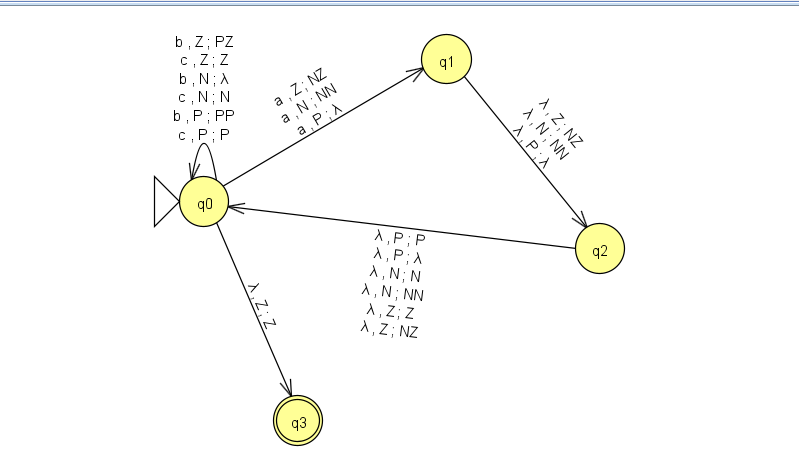

### 2.3 Пошаговое распознавание цепочки `abb`

Цепочка `abb` ($n_a = 1$, $n_b = 2$) должна быть принята. Принимающая ветвь вычисления проходит следующие конфигурации (магазин записан от вершины ко дну):

```
(q0, abb, Z)
  --a-->  (q1, bb, NZ)     первое уменьшение: x = -1
  --λ-->  (q2, bb, NNZ)    второе уменьшение: x = -2
  --λ-->  (q0, bb, NNZ)    выбрано «a ждёт 2 буквы b»
  --b-->  (q0, b, NZ)      x = -1
  --b-->  (q0, λ, Z)       x = 0
  --λ-->  (q3, λ, Z)       финальное состояние, цепочка прочитана
```

Пошаговый прогон этой цепочки в JFLAP показан на следующих скриншотах.

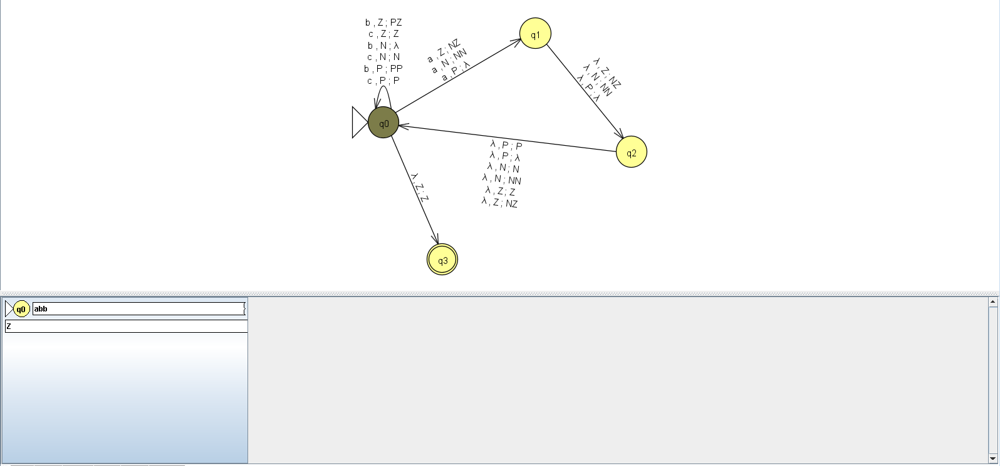

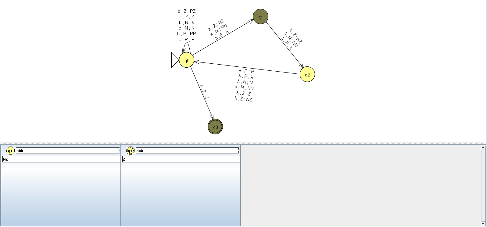

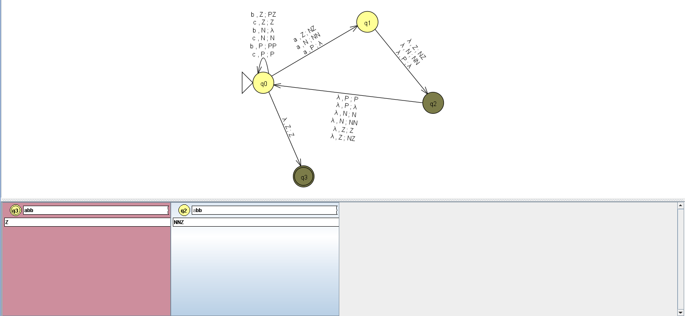


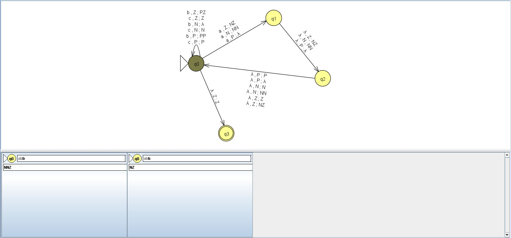

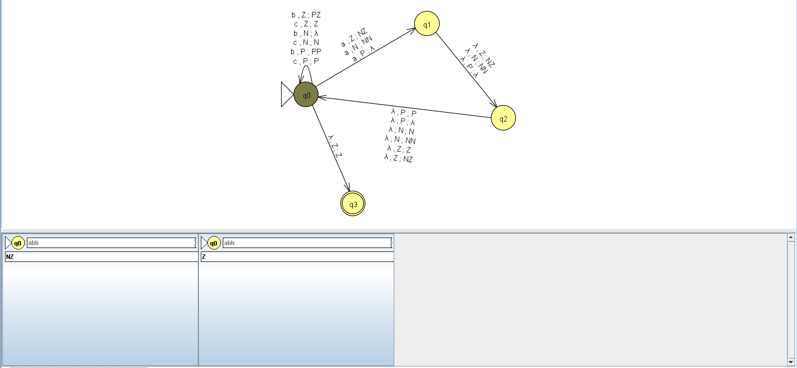

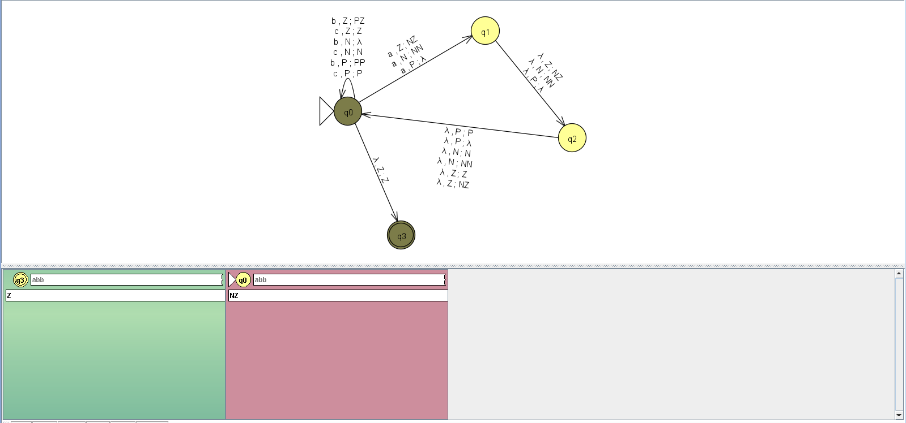

### 2.4 Проверка МПА в режиме Multiple Run

Для проверки в режиме Multiple Run введены цепочки; цепочка принимается, если $2n_a \le n_b \le 3n_a$.

| Цепочка | $n_a$ | $n_b$ | Ожидаемый результат |
|---|---|---|---|
| `abb` | 1 | 2 | принимается |
| `abbb` | 1 | 3 | принимается |
| `cabcbb` | 1 | 3 | принимается |
| `c` | 0 | 0 | принимается |
| `ab` | 1 | 1 | отклоняется |
| `aabbb` | 2 | 3 | отклоняется |
| `aabbbbbbb` | 2 | 7 | отклоняется |
| `b` | 0 | 1 | отклоняется |

Набор включает обе границы диапазона для одной буквы `a` (`abb` и `abbb`), отказы из-за недостатка (`ab`, `aabbb`) и избытка (`aabbbbbbb`) букв `b`, цепочку с символами `c`, а также цепочки без `a`. Результат прогона полностью совпал с ожидаемым.

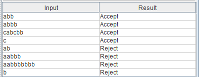

## 3 Часть 2. КСГ для языка $L_{26}$

### 3.1 Построение КСГ

Цепочка языка имеет вид $a^n b^m c^{n+m}$: число символов `c` равно сумме чисел символов `a` и `b`. Грамматика строится по принципу вложенных скобок: каждая `a` в начале цепочки и каждая `b` в её середине «получают» по одной `c` с правого края.

```
S → aSc | T
T → bTc | ε
```

- Правило `S → aSc` добавляет `a` слева и `c` справа. Применённое $n$ раз, оно даёт $a^n \ldots c^n$.
- Правило `S → T` переходит к середине цепочки, а `T → bTc` так же добавляет `b` слева и `c` справа, $m$ раз.
- Правило `T → ε` завершает вывод.

В результате получается $a^n b^m c^m c^n$, то есть ровно $n + m$ символов `c`. Например, цепочка `abcc` ($n = 1$, $m = 1$) выводится так:

```
S ⇒ aSc ⇒ aTc ⇒ abTcc ⇒ abcc
```

Грамматика, введённая в JFLAP:

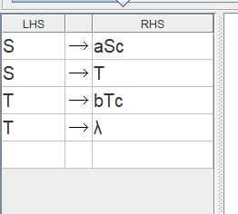

### 3.2 Распознавание цепочки `abcc` с помощью КСГ

Вывод цепочки `abcc` в JFLAP выполнен пошагово: сначала берётся начальный символ `S`, затем последовательно применяются правила `S → aSc`, `S → T`, `T → bTc` и `T → ε`. Состояния вывода показаны на следующих скриншотах.

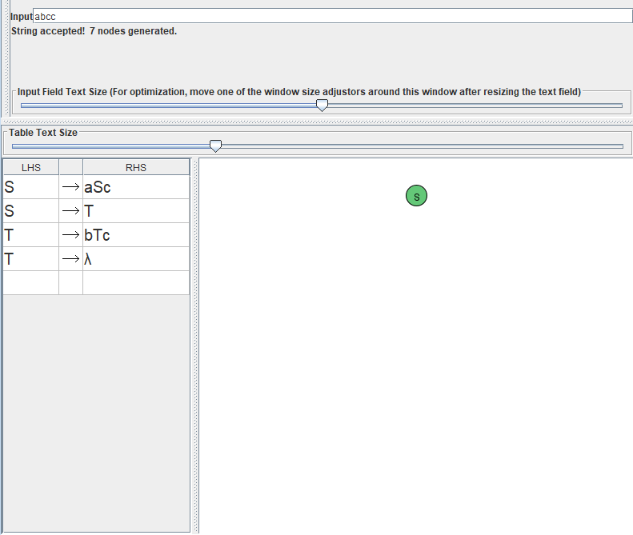

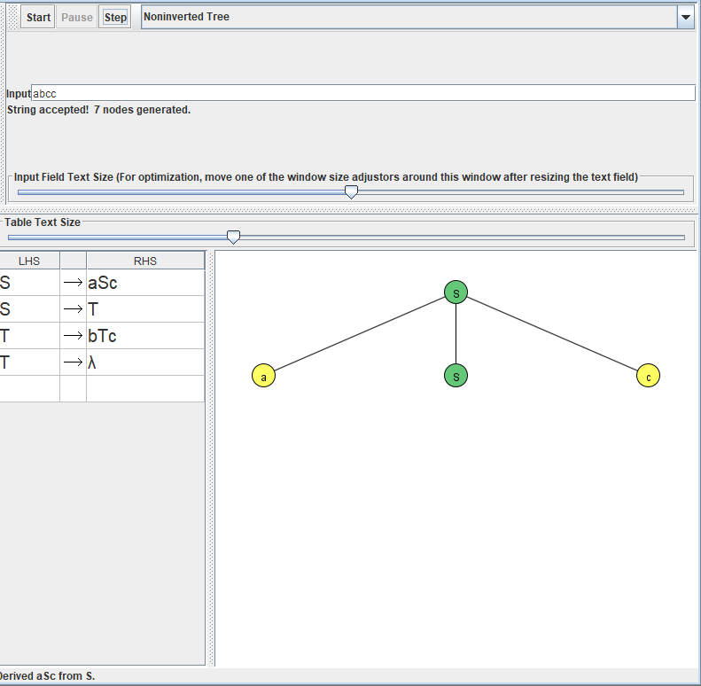

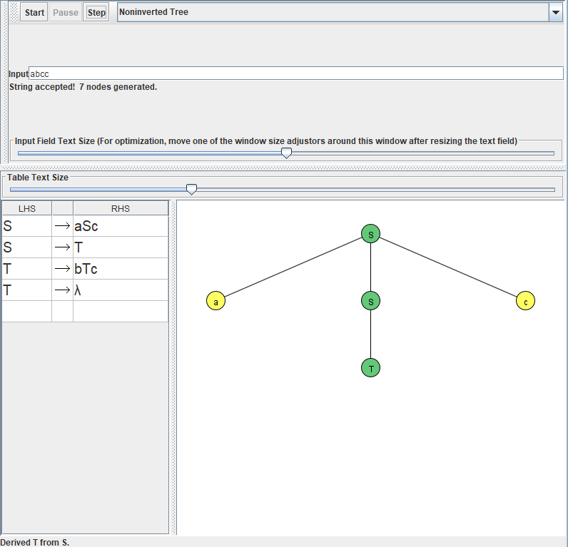

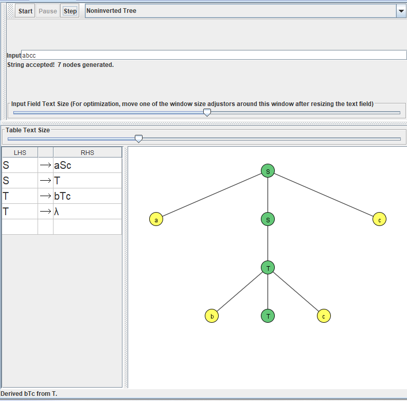

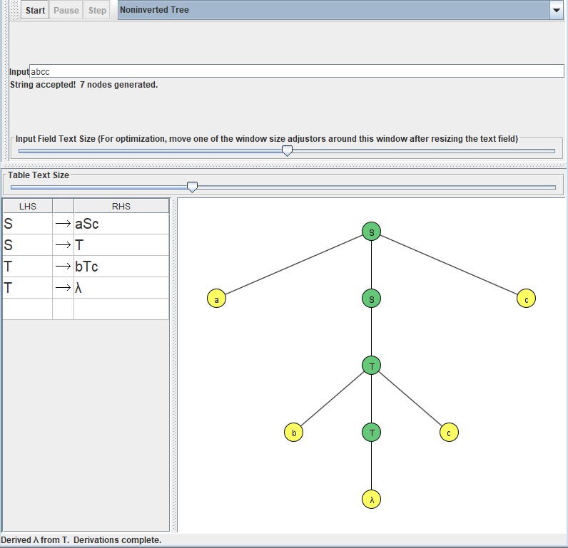

### 3.3 Проверка КСГ на наборе цепочек

Для проверки КСГ в JFLAP запущен разбор перебором на следующем наборе цепочек:

| Цепочка | $n$ | $m$ | $k$ | Ожидаемый результат |
|---|---|---|---|---|
| `ac` | 1 | 0 | 1 | выводится |
| `bc` | 0 | 1 | 1 | выводится |
| `abcc` | 1 | 1 | 2 | выводится |
| `abc` | 1 | 1 | 1 | не выводится |
| `abccc` | 1 | 1 | 3 | не выводится |
| `cab` | — | — | — | не выводится |

Результат совпал с ожидаемым: выводятся цепочки с $k = n + m$, остальные отвергаются.

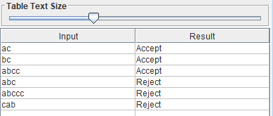

## 4 Часть 3. Доказательство того, что язык $L_{42}$ не является контекстно-свободным

**Утверждение.** Язык $L_{42} = \lbrace   a^n b^j \mid n \ge (j-1)^3  \rbrace$ не является контекстно-свободным.

**Лемма о разрастании для КС-языков.** Если язык $L$ контекстно-свободен, то существует число $p \ge 1$ такое, что любую цепочку $s \in L$ длины $|s| \ge p$ можно разбить на $s = uvwxy$, где $|vwx| \le p$, $|vx| \ge 1$ и $uv^iwx^iy \in L$ для всех $i \ge 0$.

**Доказательство (от противного).**

1. Предположим, что $L_{42}$ контекстно-свободен, и пусть $p$ — число из леммы.
2. Выберем цепочку $s = a^{p^3} b^{p+1}$. Здесь $n = p^3$, $j = p+1$, поэтому $(j-1)^3 = p^3 \le n$ и $s \in L_{42}$; кроме того, $|s| \ge p$.
3. Пусть $s = uvwxy$ — произвольное разбиение с $|vwx| \le p$ и $|vx| \ge 1$. Рассмотрим два случая.

**Случай 1.** В $vx$ нет символов `b`. Тогда $v$ и $x$ состоят только из `a`. При $i = 0$ получаем $uwy = a^{p^3 - |vx|} b^{p+1}$, где $n' = p^3 - |vx| < p^3 = (j-1)^3$. Условие $n' \ge (j-1)^3$ нарушено, поэтому $uwy \notin L_{42}$.

**Случай 2.** В $vx$ есть хотя бы один символ `b`. Берём $i = 2$.

**2а.** Подцепочка $v$ или $x$ содержит оба символа. Так как все символы `a` в $s$ стоят перед всеми `b`, такая подцепочка имеет вид $a^s b^t$, где $s, t \ge 1$, и её квадрат $a^s b^t a^s b^t$ содержит подцепочку `ba`. Цепочка $uv^2wx^2y$ не имеет вида $a^n b^j$, поэтому $uv^2wx^2y \notin L_{42}$.

**2б.** Каждая из $v$ и $x$ состоит из символов одного вида. Тогда $uv^2wx^2y = a^{n'} b^{j'}$, где число `b` увеличилось, то есть $j' \ge p + 2$, а число `a` выросло не более чем на $|vx| \le |vwx| \le p$, то есть $n' \le p^3 + p$. Тогда

$$(j'-1)^3 \ge (p+1)^3 = p^3 + 3p^2 + 3p + 1 > p^3 + p \ge n',$$

то есть $n' < (j'-1)^3$ и $uv^2wx^2y \notin L_{42}$.

4. Во всех случаях найдено $i$, при котором $uv^iwx^iy \notin L_{42}$. Это противоречит лемме о разрастании. Так как разбиение выбиралось произвольно, предположение неверно.

Следовательно, язык $L_{42}$ не принадлежит классу контекстно-свободных языков.

## 5 Заключение

В ходе практической работы для языка $L_{10}$ в системе JFLAP построен МПА с критерием принятия по финальному состоянию, который использует недетерминированный выбор и счётчик со знаком в магазине. Работа МПА проверена пошагово на цепочке `abb` и в режиме Multiple Run на наборе цепочек. Для языка $L_{26}$ построена КСГ из двух нетерминалов, её работа проверена пошаговым выводом цепочки `abcc` и разбором набора тестовых цепочек. С помощью леммы о разрастании для КС-языков формально доказано, что язык $L_{42} = \lbrace a^n b^j \mid n \ge (j-1)^3\rbrace$ не является контекстно-свободным.
